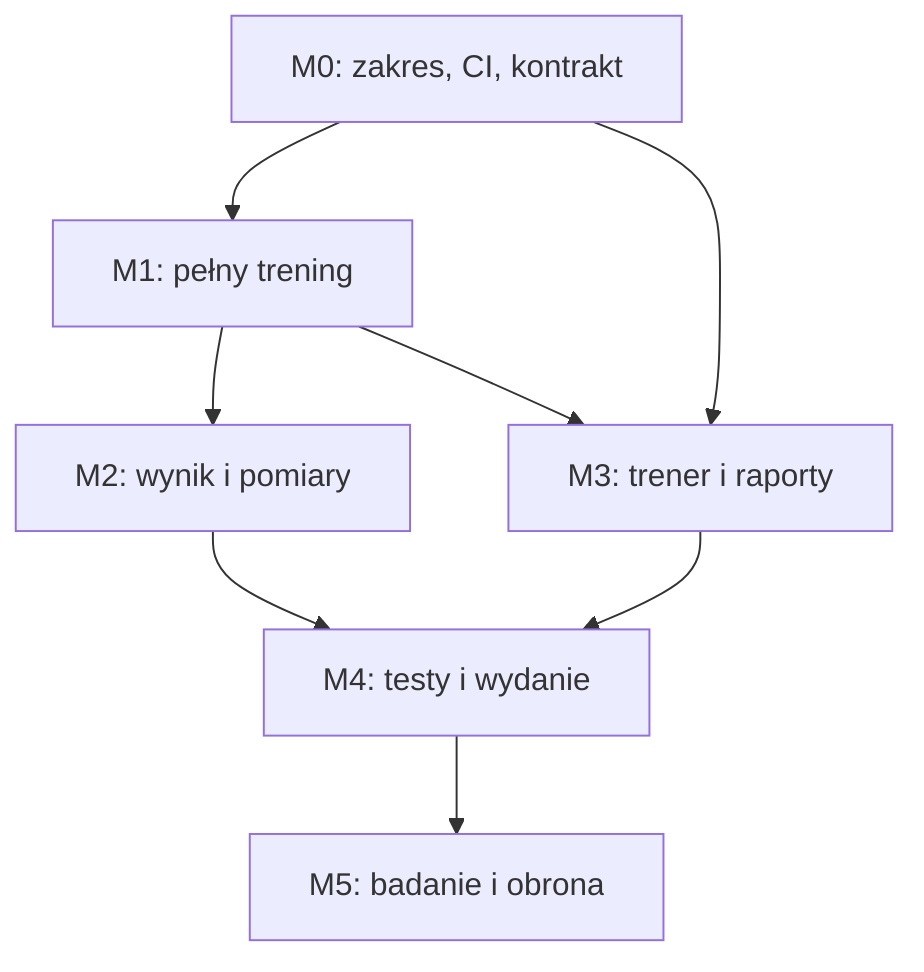

# Roadmapa ukończenia LiftContext i pracy inżynierskiej

Plan z 7 listopada 2026, na podstawie dwóch DOCX i audytu repozytoriów. Punkt wyjścia GymApp: `d3913e50ed08894a60b541768da30663feeffcc5`. To plan domknięcia istniejącej implementacji, badań i pracy, nie deklaracja ukończonej aplikacji.

**Rekomendacja:** zachować Express/Prisma/PostgreSQL, Expo React Native i panel Vue; ukończyć pełny zakres DOCX. Moduły dodatkowe pozostają niezatwierdzone. Issue decyzyjne: [LC-00 #2](https://github.com/KLesiu/GymApp/issues/2). Główna roadmapa w Issues: [#33](https://github.com/KLesiu/GymApp/issues/33).

## Dokumenty planu

- [Analiza repozytoriów i luk](docs/plan/ANALIZA.md)
- [Wybór modułów i decyzje](docs/plan/DECYZJE.md)
- [Macierz F/NF/T i warunki odbioru](docs/plan/WYMAGANIA.md)
- [Badanie, dokumentacja i obrona](docs/plan/BADANIE_I_PRACA.md)

## Etapy i bramki

| Etap | Nakład bazowy | Rezultat wymagany do zamknięcia | Zakres |
|---|---:|---|---|
| M0 — zakres i odtwarzalna baza | 26–44 h | Decyzje, pochodzenie, powtarzalny CI i konkretny kontrakt | LC-00–03 |
| M1 — kompletny trening | 50–84 h | Konto → słowniki/plan → sesja → benchmark → atomowy zapis z retry | LC-04–10 |
| M2 — wynik i postęp | 26–40 h | Poprawny rating/jednostki, podsumowanie, historia/rekordy i wszystkie pomiary | LC-11–13 |
| M3 — pełna opieka trenerska | 58–88 h | Kod relacji → plan → wersjonowany/cykliczny raport → feedback | LC-14–19 |
| M4 — zweryfikowane wydanie demo | 42–66 h | Android/iOS, pełne testy, pomiary wydajności i odtwarzalny release | LC-20–23 |
| M5 — badanie i gotowa praca | 44–70 h | Rzeczywiste wyniki P1–P4, zgodny tekst pracy i przygotowana obrona | LC-24–25 |

Razem baza: **246–392 godzin**, a z proponowanym buforem 25% około **308–490 godzin**. Dla jednej osoby pracującej 20 h/tydzień daje to orientacyjnie **16–25 tygodni**; przy 30 h/tydzień około **11–17 tygodni**. To szacunek planistyczny przed odtworzeniem środowiska, nie termin zobowiązania. Po M0 należy przeszacować zadania według potwierdzonych braków. Oczekiwanie na uczestników, promotora lub dostęp do iOS może wydłużyć kalendarz.

Nie ustalono aktualnego terminu oddania ani dostępności autora. Daty czerwiec/lipiec 2026 w sprawozdaniu są historycznym checkpointem. T0 oznacza rozpoczęcie zaakceptowanego planu. Dodatki D01–D14 nie wchodzą do sumy bazowej, a czas rekrutacji nie jest gwarantowany.

## Kolejność prac

Diagram pokazuje główne bramki; dokładne zależności są w issues. M3 może rozpocząć się po kontach/kontrakcie i nie musi czekać na cały M2. Po LC-17 formularze raportów i scheduler mogą rozwijać się równolegle. Dokumentację, ADR, dane syntetyczne i scenariusze testowe aktualizujemy od pierwszej zmiany. LC-25 zamyka dokumentację na końcu, ale nie odkłada całego pisania do M5.

Pierwsza kolejność pracy: [LC-00 #2](https://github.com/KLesiu/GymApp/issues/2) oraz niezależnie [LC-01 #3](https://github.com/KLesiu/GymApp/issues/3)/[LC-02 #4](https://github.com/KLesiu/GymApp/issues/4), potem [LC-03 #5](https://github.com/KLesiu/GymApp/issues/5). Następnie uprawnienia i odzyskiwanie treningu; równolegle przygotowanie pełnego kontraktu i kreatora raportów. Nie rozpoczynać dodatków, gdy pozostają niezakończone kryteria P0.

## Backlog podstawowy

- [ ] [LC-00 #2](https://github.com/KLesiu/GymApp/issues/2) — Zatwierdzić zakres LiftContext i wybrać moduły dodatkowe (2–4 h)
- [ ] [LC-01 #3](https://github.com/KLesiu/GymApp/issues/3) — Odtworzyć środowisko i naprawić CI wszystkich trzech aplikacji (8–12 h)
- [ ] [LC-02 #4](https://github.com/KLesiu/GymApp/issues/4) — Zweryfikować pochodzenie zasobów i odrębną identyfikację LiftContext (4–8 h)
- [ ] [LC-03 #5](https://github.com/KLesiu/GymApp/issues/5) — Ujednolicić OpenAPI i typowane kontrakty obu klientów (12–20 h)
- [ ] [LC-04 #6](https://github.com/KLesiu/GymApp/issues/6) — Domknąć logowanie, sesję i kontrolę dostępu (6–10 h)
- [ ] [LC-05 #7](https://github.com/KLesiu/GymApp/issues/7) — Zweryfikować siłownie, archiwizację i zachowanie kontekstu historii (4–6 h)
- [ ] [LC-06 #8](https://github.com/KLesiu/GymApp/issues/8) — Dokończyć własne ćwiczenia i grupy mięśniowe (8–14 h)
- [ ] [LC-07 #9](https://github.com/KLesiu/GymApp/issues/9) — Domknąć samodzielne plany wielotygodniowe (8–14 h)
- [ ] [LC-08 #10](https://github.com/KLesiu/GymApp/issues/10) — Odzyskiwać aktywną sesję i poprawnie edytować jej ćwiczenia oraz serie (8–14 h)
- [ ] [LC-09 #11](https://github.com/KLesiu/GymApp/issues/11) — Uzgodnić benchmark przy serii z historią i finalizacją (6–10 h)
- [ ] [LC-10 #12](https://github.com/KLesiu/GymApp/issues/12) — Zapewnić odporną na ponowienia finalizację treningu (10–16 h)
- [ ] [LC-11 #13](https://github.com/KLesiu/GymApp/issues/13) — Zweryfikować rating, jednostki, rangi i ich wyjaśnienie (8–12 h)
- [ ] [LC-12 #14](https://github.com/KLesiu/GymApp/issues/14) — Zastąpić atrapę podsumowania historią serii i rekordów (10–16 h)
- [ ] [LC-13 #15](https://github.com/KLesiu/GymApp/issues/15) — Dokończyć pomiary masy, obwodów i wykresy trendów (8–12 h)
- [ ] [LC-14 #16](https://github.com/KLesiu/GymApp/issues/16) — Wprowadzić relację trener–podopieczny przez kod (8–12 h)
- [ ] [LC-15 #17](https://github.com/KLesiu/GymApp/issues/17) — Zweryfikować panel i rzeczywiste dane aktywnego podopiecznego (8–12 h)
- [ ] [LC-16 #18](https://github.com/KLesiu/GymApp/issues/18) — Domknąć przypisywanie i edycję przyszłych tygodni planu (8–12 h)
- [ ] [LC-17 #19](https://github.com/KLesiu/GymApp/issues/19) — Rozbudować kreator wielopolowych raportów i utrwalone wersje (12–18 h)
- [ ] [LC-18 #20](https://github.com/KLesiu/GymApp/issues/20) — Materializować cykliczne raporty bez duplikatów (12–18 h)
- [ ] [LC-19 #21](https://github.com/KLesiu/GymApp/issues/21) — Zastąpić stały check-in formularzem raportu i feedbackiem (10–16 h)
- [ ] [LC-20 #22](https://github.com/KLesiu/GymApp/issues/22) — Odebrać UX, dostępność i działanie na Android oraz iOS (10–16 h)
- [ ] [LC-21 #23](https://github.com/KLesiu/GymApp/issues/23) — Dodać rzeczywiste testy przekrojowe i macierz odbioru F/NF (16–24 h)
- [ ] [LC-22 #24](https://github.com/KLesiu/GymApp/issues/24) — Zmierzyć wydajność i ustalić progi NF-02 (6–10 h)
- [ ] [LC-23 #25](https://github.com/KLesiu/GymApp/issues/25) — Przygotować działające wydanie demonstracyjne i odtwarzanie danych (10–16 h)
- [ ] [LC-24 #26](https://github.com/KLesiu/GymApp/issues/26) — Przeprowadzić badanie pilotażowe odpowiadające na P1–P4 (20–30 h)
- [ ] [LC-25 #27](https://github.com/KLesiu/GymApp/issues/27) — Uzgodnić pracę i sprawozdania z kodem, wynikami i obroną (24–40 h)

## Backlog warunkowy

Każdy moduł wymaga osobnego wyboru TAK/PÓŹNIEJ/NIE w [LC-00 #2](https://github.com/KLesiu/GymApp/issues/2). Tworzymy zadania do oceny, nie zobowiązanie realizacji.

- [ ] [LC-26 #28](https://github.com/KLesiu/GymApp/issues/28) — Powiadomienia, onboarding i pełne PL/EN
- [ ] [LC-27 #29](https://github.com/KLesiu/GymApp/issues/29) — Ranking społecznościowy, rekordy ręczne i dodatkowa analityka
- [ ] [LC-28 #30](https://github.com/KLesiu/GymApp/issues/30) — Notatki trenera, dieta i załączniki zdjęciowe
- [ ] [LC-29 #31](https://github.com/KLesiu/GymApp/issues/31) — Udostępnianie planów i timer przerw
- [ ] [LC-30 #32](https://github.com/KLesiu/GymApp/issues/32) — OAuth, administracja i strona informacyjna

## Warunki uznania aplikacji za w pełni działającą

1. Użytkownik zakłada konto, konfiguruje siłownię/ćwiczenia/plan, wykonuje i wznawia trening, widzi właściwy benchmark, zapisuje go mimo ponowienia żądania, odczytuje faktyczne podsumowanie, historię, rekordy i pomiary.
2. Trener nawiązuje zaakceptowaną relację, przypisuje wielotygodniowy plan i wersjonowany raport, otrzymuje prawdziwe odpowiedzi i odsyła feedback. Cykle tworzą kolejne raporty bez duplikatów.
3. Cudze dane są niedostępne; zakończenie relacji odbiera dostęp. Zmiana planów/szablonów nie niszczy historii.
4. Rating ma udokumentowane reguły i jednostki, nie gubi aktualizacji ani nie nalicza powtórnie przy retry.
5. Są dowody działania na Android/iOS, przechodzący CI i testy zachowania klientów, mierzone NF-02 oraz odtwarzalne środowisko demonstracyjne.
6. Produkt ma własną nazwę, zasoby i identyfikatory; pochodzenie użytych materiałów jest zapisane.

## Ryzyka i sposób ograniczenia

| Ryzyko | Działanie |
|---|---|
| Statusy Done w dokumentach maskują brakujące przepływy | Utrzymywać macierz wymaganie → kod → test → SHA, zamykać po odbiorze |
| Rozszerzenie zakresu o wiele modułów źródła | Dodatki poza podstawą, osobne wybory i wycena |
| Niejednoznaczny benchmark/rating | ADR i przykłady oczekiwane przed zmianą algorytmu |
| Utrata sesji/punktów przy retry lub współbieżności | Testy timeout, restart, rollback i wiele równoległych zapisów |
| Cykl i wersje raportów | Trwały snapshot, unikalność okresu, test czasu i konfliktu wersji |
| Brak urządzeń i uczestników | Ustalić dostępność w M0; zamrozić protokół przed badaniem |
| Rozbieżność deklaracji pracy z wydaniem | Aktualizować rozdziały i dowody przez cały projekt |
| Niezweryfikowane pochodzenie kodu lub marki | Własna implementacja i zasoby; audyt przed adaptacją |

Właścicielem decyzji zakresowych jest autor pracy. Issues nie zostały przypisane innym osobom ani opatrzone wymyślonymi datami. Etapy M0–M5 są logicznymi kamieniami milowymi w tej roadmapie; nie oznacza to utworzenia natywnych GitHub Milestones lub Projects.
